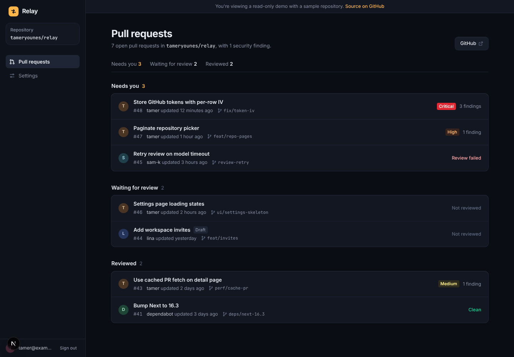
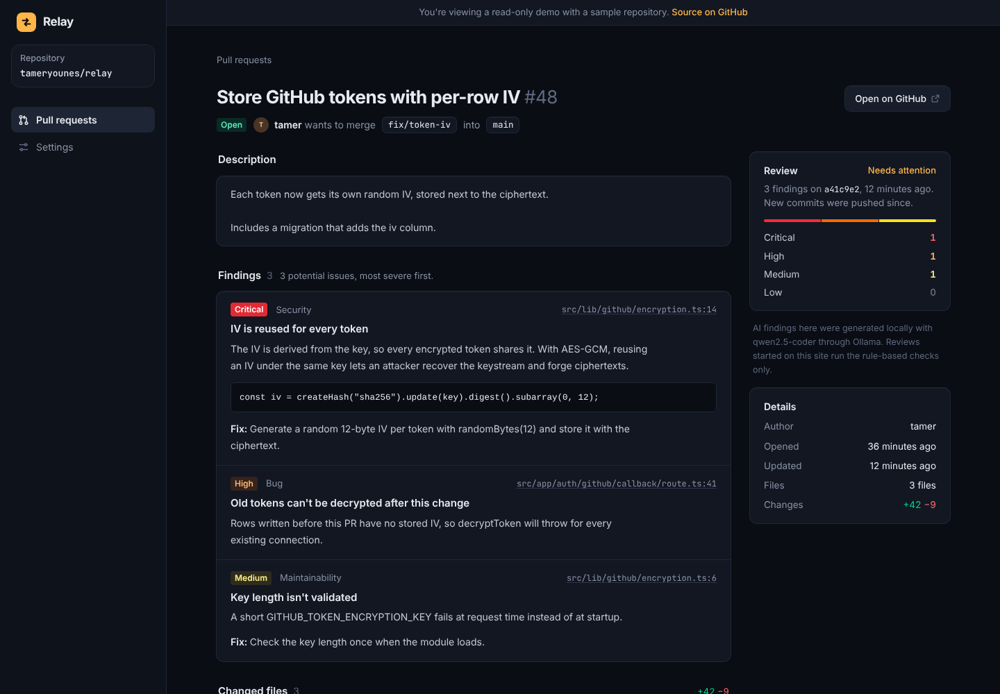

# Relay

[](https://github.com/TamerYounes/Relay/actions/workflows/ci.yml)

Relay reviews GitHub pull requests. Connect a repository and it lists the open PRs, runs a review on the changed code, and sorts everything into what needs you, what's waiting for a review, and what's already been reviewed.

**Live:** [relay-three-bice.vercel.app](https://relay-three-bice.vercel.app). Use **Try the demo** on the sign-in page to look around without an account.





_Screenshots use the read-only demo account._

## How a review works

When you run a review on a pull request, Relay fetches its diff from GitHub and runs two passes over the changed lines:

1. **Rule-based checks.** Pattern checks for hardcoded secrets, `eval()`, raw HTML injection, leftover debug logging and TODO/FIXME markers.
2. **AI review.** The diff goes to a local model, `qwen2.5-coder:7b` through [Ollama](https://ollama.com), with a prompt that asks for real bugs and security problems only, as JSON. Each finding is validated and normalized before it's saved.

The review code lives in `src/lib/review` and has no database or Next.js dependencies, so it's unit tested on its own: diff parsing, each rule, validation of the model's JSON, and what happens when the model is down or returns something unexpected.

Findings from both passes are de-duplicated and stored with the commit they were reviewed at. If new commits are pushed later, the PR page says so and offers to review them.

The AI pass runs against a local Ollama server, so it's on when Relay runs on your machine and off on the hosted site, where reviews run the rule-based checks only.

## Stack

- Next.js 16 (App Router, server components, route handlers), React 19, TypeScript
- Tailwind CSS 4
- Supabase: email auth and Postgres, with row-level security on every table
- GitHub OAuth; access tokens are encrypted with AES-256-GCM before they're stored
- Ollama for the AI review
- Vitest for unit tests, GitHub Actions for CI
- Docker for running a production build locally, Vercel for hosting

## Running it locally

You need Node 22, a Supabase project and a GitHub OAuth app.

```bash
npm install
cp .env.example .env.local   # then fill it in
npm run dev
```

Set up the database by running the files in `supabase/migrations` in order (or `supabase db push` with the Supabase CLI). New users get a workspace automatically.

For the AI review, install Ollama and pull the model:

```bash
ollama pull qwen2.5-coder:7b
```

To run a production build in Docker instead:

```bash
docker compose --env-file .env.local up --build
```

### Environment variables

| Variable | What it's for |
| --- | --- |
| `NEXT_PUBLIC_SUPABASE_URL`, `NEXT_PUBLIC_SUPABASE_PUBLISHABLE_KEY` | Supabase project |
| `GITHUB_CLIENT_ID`, `GITHUB_CLIENT_SECRET`, `GITHUB_REDIRECT_URI` | GitHub OAuth app |
| `GITHUB_TOKEN_ENCRYPTION_KEY` | 64 hex characters, encrypts stored GitHub tokens |
| `OLLAMA_URL` | Optional. Defaults to `http://127.0.0.1:11434` locally and is off on Vercel |
| `NEXT_PUBLIC_DEMO_ENABLED` | `true` to show **Try the demo** |
| `DEMO_EMAIL`, `DEMO_PASSWORD` | The demo account. Sign-in happens on the server |
| `DEMO_GITHUB_TOKEN` | Read-only GitHub token for the demo repository |

## Tests and CI

```bash
npm test                  # unit tests (Vitest)
npm run typecheck
npm run lint
npm run check:migrations  # applies every migration to an in-memory Postgres and checks RLS
```

GitHub Actions runs all of these plus a production build on every push and pull request. The migration check uses [PGlite](https://pglite.dev) with a small stand-in for Supabase's `auth` schema, and confirms that users only see their own workspace and that read-only workspaces can't write.

## The demo account

The demo is read-only at two levels. The app blocks reviews, repository changes and GitHub connections for it, and the database blocks every write for workspaces marked `read_only` (see `supabase/migrations`). It reads GitHub with its own token that can only see the public [Relay-demo](https://github.com/TamerYounes/Relay-demo) repository, never a real user's connection. That repository is a small storefront with open pull requests that have problems in them on purpose, plus one clean one.
